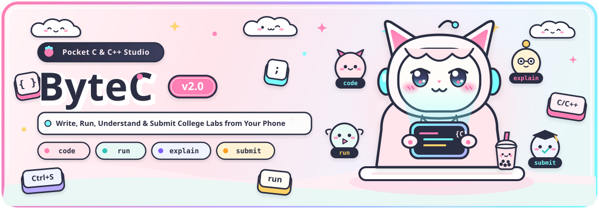

<p align="center"></p>

# ByteC v2.0: Pocket C & C++ Studio for Android Termux

<p align="center">
  <a href="LICENSE"></a>
  
  
  <a href="https://0xopcode.github.io/ByteC/"></a>
  <a href="VERSION"></a>
</p>

ByteC turns Android Termux into a complete C and C++ programming studio with one command. It installs Clang, a VS Code-mapped Neovim editor, an offline error translator, an automated test verifier, a PDF/DOC lab report generator, and 18 college DSA templates in 120MB of space. Zero proot containers required.

Read the interactive beginner guide: [0xopcode.github.io/ByteC](https://0xopcode.github.io/ByteC/)

---

## Why I Built ByteC

I built ByteC after sitting in first-year college C programming labs and watching the same disasters unfold every week.

Half the class did not own a laptop. When they asked how to practice C on their phones, seniors told them to install a 5GB Ubuntu proot container inside Termux, which ate their storage, cooked their battery in twenty minutes, and lagged on every keystroke. The ones who tried raw Termux hit `gcc: command not found` on question one because the lab sheet assumed a 2010 Ubuntu desktop.

Even writing five lines of code on an Android keyboard felt like defusing a bomb. Typing `scanf("%d", &x);` meant flipping through three symbol pages to find quotes, percent signs, ampersands, and semicolons. When someone forgot that one `&` in `scanf`, the terminal printed `Segmentation fault` with zero explanation and died. And when a brave student opened Vim to edit a file, they got trapped in Normal mode with no idea how to quit, so they force-closed Termux or rebooted their phone.

ByteC fixes the whole first-year survival problem:
- **120MB native setup:** No proot container, no 5GB Ubuntu image, zero lag.
- **Plain-English commands:** Type `code`, `run`, `explain`, `check`, `fix`, or `submit`.
- **Offline error & crash tutor (`explain`):** Translates cryptic Clang messages and `Segmentation fault` crashes into plain English with exact line numbers and before/after fixes.
- **Pre-submission safety net (`check`):** Catches infinite loops after 5 seconds, scans for uninitialized variables, and runs multi-case tests.
- **1-command lab reports (`submit`):** Generates formatted `.doc` and `.pdf` lab records with your name, roll number, source code, and terminal output inside `/sdcard/Download/ByteC`.
- **Neovim without the trap:** Standard VS Code shortcuts (`Ctrl+S`, `Ctrl+C`, `Ctrl+V`, `Ctrl+Z`, `Space+r`) plus a 2-row C symbol touch bar above your phone keyboard.

---

## 1-Click Installation

> **Important for new Termux users:** Do not install Termux from the Google Play Store. The Play Store build is deprecated and fails with broken package mirrors. Install Termux from [F-Droid](https://f-droid.org/packages/com.termux/) or [GitHub Releases](https://github.com/termux/termux-app/releases).

Open Termux and paste:

```bash
curl -sL https://raw.githubusercontent.com/0xOpCode/ByteC/main/install.sh | bash
```

When installation finishes, reload your shell:

```bash
source ~/.bashrc
```

Launch the interactive studio menu at any time:

```bash
bytec
```

---

## How ByteC Compares

| College Lab Problem | Standard Termux / Proot | ByteC v2.0 |
| :--- | :--- | :--- |
| Storage footprint | 3GB to 5GB (Ubuntu proot) | **120MB (Native Termux packages)** |
| `gcc: command not found` | Manual Clang flag translation | **`gcc` and `g++` wrappers included** |
| Cryptic compiler errors | Raw Clang diagnostics | **`explain` translates 25+ errors + segfaults** |
| Infinite `while(1)` loops | Terminal freezes until force-killed | **`check` halts loops at 5s with diagnostics** |
| College lab submissions | Manual screenshots + Word formatting | **`submit` builds `.doc` and `.pdf` in `Downloads/ByteC`** |
| Mobile C punctuation | Hidden across 3 keyboard symbol pages | **2-row touch bar with `{ } ( ) [ ] # < > & * = ; "`** |
| Editor keybindings | Raw modal Vim | **VS Code shortcuts (`Ctrl+S/C/V/X/A/Z/Y`, `Space+r`)** |
| University boilerplate | Write everything from scratch | **18 built-in C & C++ DSA templates** |

---

## The v2.0 Beginner Command Suite

ByteC v2.0 introduces single-word commands that remember the file you last edited. If you omit the filename, ByteC operates on your active file.

| Command | Usage | What It Does |
| :--- | :--- | :--- |
| `bytec` | `bytec` | Opens the interactive ByteC Studio TUI menu |
| `code` | `code [file.c]` | Creates or opens a C/C++ file (picker opens if no file given) |
| `run` | `run [file.c]` | Compiles and runs your code; invokes `explain` on any failure |
| `explain` | `explain [file.c]` | Translates compiler errors and runtime crashes into plain English |
| `check` | `check [file.c] [tests.txt]` | Runs 4-layer code audit, 5s loop watchdog, and test cases |
| `fix` | `fix [file.c]` | Formats code into clean Allman indentation and checks syntax |
| `submit` | `submit [file.c]` | Generates `.doc` and `.pdf` lab reports in `/sdcard/Download/ByteC` |
| `learn` | `learn [topic]` | Opens interactive offline C/DSA lessons and practice challenges |
| `debug` | `debug [file.c]` | Launches guided GDB session with a beginner reference card |

---

## Classic Command Suite

Every v1 command remains available for power users and shell scripts:

### `cnew` (Alias: `code`) - File & Template Generator

```bash
code                        # Interactive prompt for filename and template
code lab1.c                 # Create starter C file and open in Neovim
code app.cpp                # Create starter C++ file and open in Neovim
cnew lab2.c -t linkedlist   # Create from one of 18 built-in templates
cnew -l                     # List all 18 college lab and DSA templates
```

### `crun` (Alias: `run`) - Compile, Run & Auto-Diagnose

```bash
run                         # Compile and run the last edited file
run lab1.c                  # Compile and run lab1.c with execution timer
crun lab1.c -i input.txt    # Feed stdin from input.txt
crun lab1.c -g              # Compile with debug symbols (-g -O0)
crun main.c utils.c         # Compile multiple files together
crun lab1.c -- arg1 arg2    # Pass command-line arguments to your program
```

### `cbuild` - Multi-File Project Builder

```bash
cbuild                      # Build project (prompts if folder has multiple main() files)
cbuild main.c engine.c -o game
cbuild clean                # Remove compiled binaries and object files
```

### `cformat` (Alias: `fix`) - Allman & Google Formatter

```bash
fix lab1.c                  # Format in college-standard Allman brace style
cformat --all               # Format all C/C++ files in current directory
cformat -s google lab1.c    # Format using Google style
```

### `cdebug` (Alias: `debug`) & `ctest` (Alias: `check`)

```bash
debug lab1.c                        # Start GDB with beginner command cheat sheet
check lab1.c                        # Run 4-layer static + runtime verification
check lab1.c tests.txt              # Run multi-case test suite
ctest lab1.c input.txt expected.txt # Compare output against expected file
```

### `gcc` and `g++` Wrappers

Type exact commands from university lab manuals without errors:

```bash
gcc lab1.c -o lab1 -lm
./lab1
```

---

## Deep Dive: How `explain`, `check`, and `submit` Work

### 1. `explain` - Offline Error & Crash Tutor

When compilation fails or your program crashes at runtime, run `explain` (or let `run` invoke it). It operates 100% offline in three stages:

1. **Static Diagnostic Capture:** Runs Clang with `-Wall -Wextra -Wformat -Wuninitialized` and extracts the exact offending line and preceding context.
2. **25+ Student Pattern Rules:** Matches common beginner mistakes and prints **Where**, **What Happened**, and a **Before vs After** fix:
   - Missing `;` on the previous line (`expected ';' after expression`).
   - Missing `&` in `scanf("%d", x)` (`format '%d' expects 'int *'`).
   - Using `=` instead of `==` inside `if (x = 5)`.
   - Uninitialized variables holding stack garbage (`int sum;` without `= 0`).
   - Case typos or missing headers (`printf` -> `<stdio.h>`, `malloc` -> `<stdlib.h>`, `sqrt` -> `<math.h>`, `strlen` -> `<string.h>`).
   - Removed `gets()` usage with `fgets()` replacement.
   - Out-of-bounds array indexing (`arr[5]` on `int arr[5]`).
3. **Runtime Crash Forensics:** If your code compiles but crashes when running, `explain` inspects the exit signal and stack frame:
   - **`SIGSEGV` (Exit 139 - Segmentation Fault):** Pinpoints the crashing line number, pointer/array expression, and local variable values.
   - **`SIGFPE` (Exit 136 - Floating Point Exception):** Pinpoints division or modulo by zero (`a / b` where `b == 0`).
   - **`SIGABRT` (Exit 134 - Aborted):** Identifies double `free()` or buffer overflow.

### 2. `check` - 4-Layer Verifier & Infinite Loop Guard

Run `check lab1.c` before submitting code to your professor:

1. **Layer 1 (Static Bug Audit):** Flags `scanf` without `&`, `fflush(stdin)`, `void main()`, `gets()`, uninitialized variables, and `malloc()` calls without matching `free()`.
2. **Layer 2 (Memory & UB Guard):** Compiles with stack protection and bounds instrumentation to catch buffer overflows and null pointer dereferences.
3. **Layer 3 (5-Second Infinite Loop Watchdog):** Runs your binary under a 5-second timer. If a `while(1)` or broken `for` loop hangs, `check` kills the process and points you to your loop condition.
4. **Layer 4 (Multi-Case Test Runner):** Supports single or multiple test cases in one file:

```text
--- INPUT ---
5 10
--- EXPECTED ---
15
--- INPUT ---
-3 8
--- EXPECTED ---
5
```

### 3. `submit` - College Lab Record Generator (`.doc` & `.pdf`)

Run `submit lab1.c` to package your code and output for college portals or print shops:

1. **Storage Permission Check:** Verifies write access to `/sdcard/Download/ByteC`. If Termux lacks storage access, `submit` launches `termux-setup-storage`, waits for you to tap **Allow**, and creates the folder.
2. **Student Profile Cache:** Saves your Name, Roll Number, and Batch once in `~/.bytec/student_profile.conf` so you never retype them for future labs.
3. **Execution Transcript Capture:** Compiles and runs your code, echoing typed inputs next to prompts (`Enter number: 29`) so your output box looks like a real terminal session.
4. **Dual-Format Output (Zero Dependencies):**
   - `/sdcard/Download/ByteC/lab1_LabReport.doc` - Word-compatible RTF 1.5 document with header table, line-numbered `Courier New` source box, and dark terminal output block. Opens in Microsoft Word, WPS Office, Google Docs, and LibreOffice.
   - `/sdcard/Download/ByteC/lab1_LabReport.pdf` - Native PDF 1.4 document generated offline via POSIX `awk` with pagination, bordered code boxes, and dark terminal output block.

---

## 18 Built-in College Lab & DSA Templates

Generate any template with `code myfile.c -t <template>` or `cnew myfile.c -t <template>`:

| Template | Language | Command | Topics Covered |
| :--- | :--- | :--- | :--- |
| `hello` | C | `code lab.c -t hello` | `main()` structure, CLI arguments, formatted `printf` |
| `linkedlist` | C | `code lab.c -t linkedlist` | Single-link list insert, delete, search, display, `free` |
| `doublylinkedlist` | C | `code lab.c -t doublylinkedlist` | Double-link list head/tail insert, delete, forward/reverse print |
| `stack` | C | `code lab.c -t stack` | Array stack push, pop, peek, overflow and underflow checks |
| `queue` | C | `code lab.c -t queue` | Circular queue enqueue, dequeue, front/rear wrap-around |
| `binarytree` | C | `code lab.c -t binarytree` | Binary Search Tree insert, search, inorder/preorder/postorder |
| `graph` | C | `code lab.c -t graph` | Graph adjacency matrix/list with BFS and DFS traversals |
| `sort` | C | `code lab.c -t sort` | Bubble sort, Selection sort, and Insertion sort with step counts |
| `quicksort` | C | `code lab.c -t quicksort` | Divide-and-conquer QuickSort and MergeSort implementations |
| `searching` | C | `code lab.c -t searching` | Linear search, iterative Binary search, recursive Binary search |
| `recursion` | C | `code lab.c -t recursion` | Factorial, Fibonacci, Euclidean GCD, and Tower of Hanoi |
| `matrix` | C | `code lab.c -t matrix` | 2D matrix addition, multiplication, and transpose |
| `pointers` | C | `code lab.c -t pointers` | Pass-by-reference swap, pointer arithmetic, `malloc`/`free` arrays |
| `strings` | C | `code lab.c -t strings` | Length, copy, compare, reverse, and palindrome without `<string.h>` |
| `structures` | C | `code lab.c -t structures` | `struct` student records, array of structs, sorting by marks |
| `fileio` | C | `code lab.c -t fileio` | File write, append, EOF-safe line read, word/line counter |
| `stl` | C++ | `code lab.cpp -t stl` | C++ STL `vector`, `map`, `set`, `unordered_map`, `priority_queue`, `sort` |
| `oop` | C++ | `code lab.cpp -t oop` | C++ classes, constructors, encapsulation, inheritance, virtual methods |

---

## ByteC Studio & CLI Manager (`bytec`)

Run `bytec` with no arguments to open the interactive Studio TUI, or run subcommands:

| Command | Action |
| :--- | :--- |
| `bytec` | Launch interactive ByteC Studio TUI menu |
| `bytec doctor` | Audit compilers, storage links, permissions, git config, and free space |
| `bytec learn` | Start interactive offline C lessons and coding challenges |
| `bytec resources` | View curated links for C, C++, DSA, Linux, and Termux |
| `bytec cheatsheet <topic>` | View offline reference for `printf`, `pointers`, `strings`, `loops`, `dsa`, `keys` |
| `bytec tutorial` | Run 60-second interactive onboarding walkthrough |
| `bytec git` | View or configure Git author name and email |
| `bytec share <file.c>` | Upload code to paste service and copy URL to clipboard |
| `bytec backup` | Archive `~/c_projects` to `/sdcard/Download/` |
| `bytec restore <archive>` | Restore workspace from backup archive |
| `bytec stats` | Show file counts, line counts, and workspace size |
| `bytec update` | Pull latest ByteC tools and Neovim configuration |
| `bytec status` | Show installed tool versions and commit hashes |
| `bytec version` | Print current ByteC version (`2.0.0`) |
| `bytec uninstall` | Uninstall ByteC while keeping `~/c_projects` intact |

---

## Neovim v2.0: VS Code Shortcuts & Survival Guide

ByteC configures Neovim (`0xOpCode/nvim` v2.0) with familiar VS Code shortcuts across Normal, Insert, and Visual modes while preserving Allman brace indentation on save.

| Shortcut | Action |
| :--- | :--- |
| `<Space> + r` or `F5` | Save, format in Allman style, compile in `$TMPDIR`, and run (runs `explain` on error) |
| `Ctrl + s` | Save file and format with Allman braces |
| `Ctrl + c` | Copy selection (or current line) to Android/system clipboard |
| `Ctrl + v` | Paste from Android/system clipboard |
| `Ctrl + x` | Cut selection (or current line) to clipboard |
| `Ctrl + a` | Select entire file |
| `Ctrl + /` | Toggle line or block comment (`//`) |
| `Ctrl + z` | Undo last change (works in both Normal and Insert mode) |
| `Ctrl + y` | Redo change |
| `Ctrl + d` | Select word under cursor / jump to next occurrence |
| `Ctrl + j` | Toggle floating terminal inside Neovim |
| `<Space> + e` | Toggle file explorer sidebar |
| `<Space> + ff` | Fuzzy-find files in workspace |
| `i` / `ESC` | Enter Insert mode (type text) / Return to Normal mode (commands) |
| `:wq` + `Enter` | Save and quit Neovim |
| `ZQ` (or `:q`) | Quit Neovim without saving changes |

---

## Upgraded 2-Row C/C++ Touch Bar

ByteC configures a 2-row hardware symbol bar above your Android keyboard with every operator needed for `#include <stdio.h>`, `scanf("%d", &x)`, pointers, and arrays:

```text
Row 1: [ ESC  | TAB  | CTRL | ALT   | { | } | ( | ) | ; | " ]
Row 2: [ LEFT | DOWN | UP   | RIGHT | # | < | > | & | * | = ]
```

Swipe or long-press keys on the touch bar to access secondary symbols (`[`, `]`, `\`, `|`, `/`, `-`, `_`).

---

## Where to Learn C, C++, Linux & Termux

All links below are free and work on mobile browsers:

### C Programming (Zero to Hero)
- **[Beej's Guide to C Programming](https://beej.us/guide/bgc/)** - Witty, conversational, and thorough C book for beginners.
- **[Learn-C.org](https://www.learn-c.org/)** - Bite-sized interactive C tutorials from variables to pointers and linked lists.
- **[Harvard CS50x (Weeks 1-5)](https://cs50.harvard.edu/x/)** - World-class visual lectures on C, memory, pointers, Valgrind, and data structures.
- **[Comp.lang.c FAQ (C-FAQ)](https://c-faq.com/)** - Definitive answers to classic pointer, array, `scanf`, and undefined behavior questions.

### C++ & Data Structures / Algorithms (DSA)
- **[LearnCPP.com](https://www.learncpp.com/)** - Structured, modern C++ curriculum covering basics through OOP and STL.
- **[VisuAlgo](https://visualgo.net/)** - Step-by-step interactive animations for Linked Lists, Stacks, Queues, Trees, Graphs, and Sorting.
- **[CP-Algorithms](https://cp-algorithms.com/)** - Clear explanations and C++ implementations of data structures and algorithms.
- **[cppreference.com](https://en.cppreference.com/)** - Complete technical reference for C and C++ standard library headers and functions.

### Linux, Terminal & Git
- **[Linux Journey](https://linuxjourney.com/)** - Accessible lessons on the command line, files, permissions, and processes.
- **[MIT Missing Semester](https://missing.csail.mit.edu/)** - Practical lectures on the shell, Vim/Neovim, debugging, and Git.
- **[OverTheWire: Bandit](https://overthewire.org/wargames/bandit/)** - Learn Linux terminal commands through a hands-on SSH puzzle game.
- **[ExplainShell](https://explainshell.com/)** - Paste any shell command to see a visual breakdown of every flag and argument.

### Termux & Neovim Mastery
- **[Termux Official Wiki](https://wiki.termux.com/wiki/Main_Page)** - Official guide to Termux storage, touch keyboards, and package management.
- **[OpenVim Interactive Tutorial](https://www.openvim.com/)** - 15-minute browser-based practice for Vim and Neovim navigation keys.

---

## Directory Structure

```text
~/.bytec/
├── bin/
│   ├── bytec               # Interactive Studio TUI & CLI manager
│   ├── code                # Beginner file/template creator & opener
│   ├── run                 # Beginner compile, run & auto-explain tool
│   ├── explain             # Offline compiler error & crash tutor
│   ├── check               # 4-layer verifier, 5s loop guard & test runner
│   ├── fix                 # Allman code formatter & syntax check
│   ├── submit              # .doc & .pdf college lab report generator
│   ├── learn               # Interactive offline C tutorials & challenges
│   ├── debug               # Beginner alias for guided GDB debugger
│   ├── cnew                # Classic file and template generator
│   ├── crun                # Classic compile and run tool
│   ├── cbuild              # Smart multi-file compiler
│   ├── cformat             # Classic code formatter
│   ├── cdebug              # Classic GDB wrapper
│   ├── ctest               # Classic automated test runner
│   ├── gcc                 # Safe Clang wrapper for gcc commands
│   └── g++                 # Safe Clang++ wrapper for g++ commands
├── config/
│   ├── templates/          # 18 C & C++ college lab and DSA templates
│   ├── clang-format        # Default Allman brace style config
│   ├── termux.properties   # 2-row C/C++ symbol touch bar config
│   ├── colors.properties   # Pure black OLED color scheme
│   └── banner.sh           # Terminal startup banner
├── shell/
│   ├── aliases.sh          # Shell aliases & PATH setup
│   └── prompt.sh           # Bash & Zsh compatible Git prompt
├── docs/                   # Interactive beginner web documentation
├── VERSION                 # Release version (2.0.0)
└── install.sh              # 1-click installer
```

---

## License

MIT License. Copyright (c) 2026 Akashdeep (0xOpCode).
